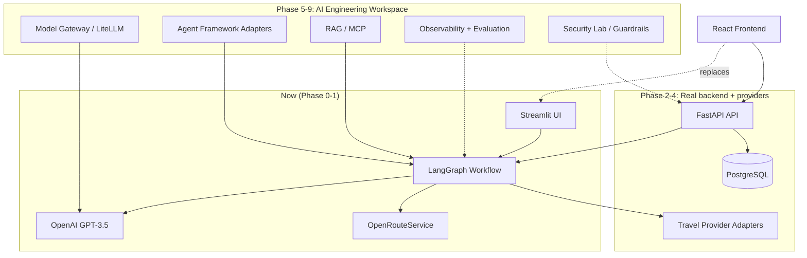

# VOYAGER AI — MASTER BLUEPRINT

Authoritative architecture and implementation contract for the Voyager AI brownfield transformation. This document supersedes `Promt.txt` as a spec source — `Promt.txt` is the original transformation request; this file is the plan derived from auditing the actual repository against it.

Status date: 2026-11-11.

---

## 1. Executive Summary

Voyager AI today is a **working, small-scale prototype**: a Streamlit UI driving a 4-agent LangGraph workflow (Research → Accommodation → Dining → Itinerary) that uses OpenAI GPT-3.5-turbo for content generation and OpenRouteService for geocoding/routing. It has no database, no auth, no tests, no CI, and (until this transformation) no git history. ~2,200 lines of Python total.

The transformation request (`Promt.txt`) describes a full AI-powered travel platform *and* a configurable AI-engineering playground (model gateway, multi-framework agents, RAG, MCP, observability, evaluation, guardrails, integration marketplace) on a React/FastAPI/Postgres stack with real travel-provider bookings.

**Reality gap:** the target is an enterprise-scale, multi-quarter platform; the current repo is a weekend-project prototype with a Streamlit UI (not React), no backend API layer, no persistence, and no existing tests/CI to preserve. Nearly every "PRESERVE the existing X" instruction in the source prompt (existing React components, existing FastAPI endpoints, existing Postgres schema, existing CI) has no current counterpart to preserve — those sections of the brownfield audit are reported as **N/A, to be built new** rather than retrofitted.

This document is scoped to be honest about that gap: it classifies what exists, defines the target architecture, and lays out phases that can actually be executed and tested one at a time, rather than claiming the full 12-phase vision is one session's work. Phase 0 and Phase 1 are achievable now; later phases are sequenced but gated on explicit go-ahead since each is a substantial, multi-session effort and several depend on provider credentials the user must supply.

---

## 2. Repository Audit (Phase 0 findings)

### 2.1 Current structure

```
voyager-ai-main/
├── app/
│   ├── agents/
│   │   ├── research_agent.py        (134 lines) — GPT-3.5 attraction generation
│   │   ├── accommodation_agent.py   (279 lines) — GPT hotel generation + ORS geocoding + proximity scoring
│   │   ├── dining_agent.py          (325 lines) — GPT restaurant generation + dietary filter + 50km radius filter
│   │   └── itinerary_agent.py       (635 lines) — route optimization (nearest-neighbor), scheduling, meal placement
│   ├── services/ors_api.py          (139 lines) — OpenRouteService geocode/matrix wrapper
│   ├── utils/logger.py              — basic logging setup
│   ├── config.py                    — env-driven settings, validates OPENAI_API_KEY at import time
│   ├── main.py                      (338 lines) — CLI entry point
│   └── workflow.py                  (206 lines) — LangGraph StateGraph orchestration
├── streamlit_app.py                 (363 lines) — Streamlit web UI
├── Voyager-AI-SVG-Components/       — standalone SVG asset library (not yet wired into any frontend)
├── docs/design/references/          — 4 reference images (UI mockups)
├── Promt.txt                        — the transformation brief itself, saved to the repo
├── requirements.txt, Dockerfile, docker-compose.yml, README.md, .gitignore
```

No `tests/`, no `.github/workflows/`, no `data/` directory yet (README references `data/itineraries/` but it's created at runtime), no `.env.example` present despite README referencing it.

### 2.2 Module classification

| Module | Responsibility | Status | Decision | Notes |
|---|---|---|---|---|
| `app/workflow.py` | LangGraph 4-agent orchestration | Working | **PRESERVE / EXTEND** | This is the travel engine's core — wrap with framework adapters later, don't rewrite |
| `app/agents/research_agent.py` | Attraction discovery via GPT | Working | **PRESERVE / EXTEND** | Swap direct OpenAI calls for model-gateway calls in Phase 5, logic stays |
| `app/agents/accommodation_agent.py` | Hotel generation + proximity scoring | Working | **PRESERVE / EXTEND** | Real provider integration (Amadeus/Booking.com) replaces GPT-generated hotel data in Phase 3; proximity scoring logic reusable |
| `app/agents/dining_agent.py` | Restaurant generation + filtering | Working | **PRESERVE / EXTEND** | Same pattern — swap data source, keep filtering logic |
| `app/agents/itinerary_agent.py` | Scheduling + route optimization | Working | **PRESERVE** | Most mature module; real travel-time data already integrated via ORS |
| `app/services/ors_api.py` | Geocoding/routing | Working | **PRESERVE / EXTEND** | Becomes one adapter in the Maps provider category (Section 9) |
| `app/config.py` | Env config | Working, minimal | **EXTEND** | Needs to grow into the settings backbone for a provider/integration registry; currently validates `OPENAI_API_KEY` at import time (side effect on import — flagged as tech debt, fix in Phase 1) |
| `streamlit_app.py` | Web UI | Working | **PRESERVE short-term, REPLACE in Phase 2+** | Keep as the demo/ops UI while a FastAPI + new frontend is built; do not delete until the replacement is functional end-to-end |
| `app/main.py` | CLI | Working | **PRESERVE** | Useful for scripted testing of the workflow without the UI |
| Database / persistence | — | **Does not exist** | **BUILD NEW** | No ORM, no migrations, no schema. Nothing to preserve. |
| Backend API (FastAPI routes) | — | **Does not exist** | **BUILD NEW** | `fastapi`/`uvicorn` are in requirements.txt but unused — aspirational dependency only |
| React frontend | — | **Does not exist** | **BUILD NEW** | Current frontend is Streamlit; a React rewrite is a Phase 2+ decision, not a preservation task |
| Tests / CI | — | **Does not exist** | **BUILD NEW** | No pytest files despite pytest in requirements.txt |
| Auth/authorization | — | **Does not exist** | **BUILD NEW** | Single-user, no accounts |
| Model gateway / LiteLLM | — | **Does not exist** | **BUILD NEW** (Phase 5) | Currently direct `langchain-openai` calls |
| Agent framework adapters (CrewAI, AutoGen) | — | **Does not exist** | **BUILD NEW** (Phase 6) | LangGraph only today |
| RAG / MCP / Observability / Evaluation / Security Lab / Integration Marketplace | — | **Does not exist** | **BUILD NEW** (Phases 7–9) | Entirely new subsystems |

### 2.3 Original PRD reconciliation

`Promt.txt` *is* the current governing brief — there is no separate, older PRD to reconcile against. No conflicting prior requirements were found. The README.md documents the as-built prototype accurately and is consistent with the code; it should be rewritten once Phase 2+ changes the stack, but is not contradicted by anything found in the audit.

---

## 3. SVG / UI Asset Inventory (Section 3.2 of the brief)

Location: `Voyager-AI-SVG-Components/Voyager-AI-SVG-Components/`. These are **standalone icon/illustration assets, not components with props** — plain `.svg` files, not React/JSX components. They are not currently imported anywhere (Streamlit does not consume them; no frontend code references this folder). Treat this as a design-asset library to wire into the frontend once one exists, not as already-integrated UI.

| Asset | Path | Type | Current usage | Reusability | Required action |
|---|---|---|---|---|---|
| agent, database, evaluation, mcp, model, observability, rag, security, workflow | `AI-Engineering/*.svg` | Icon set | None (unused) | High | Preserve; wrap as React icon components in Phase 2+ frontend build |
| badge-success, badge-warning, button-primary, button-secondary, card-outline, input-search, toggle-off/on | `Components/*.svg` | UI primitive mockups | None (unused) | Medium | These look like static mockups of components, not reusable components themselves (no viewBox/prop inspection shows parametrization). Use as the *visual reference* for building real React components (Button, Card, Toggle, Badge, Input) rather than embedding the SVGs directly as controls |
| ai-workflow, bali-temple, mountain-lake, travel-planner | `Illustrations/*.svg` | Illustration | None (unused) | High | Preserve as-is; use directly as decorative illustrations (empty states, hero sections) |
| voyager-logo, voyager-mark, voyager-wordmark | `Logos/*.svg` | Branding | None (unused) | High | Preserve exactly; use for app header/favicon |
| bookings, budget, compass, group-trips, home, my-trips, notifications, plan-trip, settings | `Navigation/*.svg` | Nav icon set | None (unused) | High | Maps directly to the navigation structure in Section 14 of the brief — preserve and use as-is for the primary nav |
| connected, error, success, warning | `Status/*.svg` | Status icon set | None (unused) | High | Preserve; use for integration/connection status indicators (Section 7) |
| activities, currency, flights, hotels, itinerary, map, restaurant, weather | `Travel/*.svg` | Domain icon set | None (unused) | High | Preserve; maps cleanly to Travel Workspace nav items |

**Verdict:** this is a clean, well-organized, directly-usable icon/illustration library for the target navigation and domain model. No duplicates found, no reason to replace anything. The 4 images in `docs/design/references/` are the UI mockup reference required by Section 12 of the brief — they should be inspected visually before any frontend work begins (not yet done in this pass; do this as the first step of Phase 2).

---

## 4. Target Architecture (incremental, not big-bang)

Given the gap in Section 1, the target architecture is built **in layers that each produce a working, demoable increment**, not as a single simultaneous React+FastAPI+Postgres+12-integration rewrite.



Stack decisions carried forward from the brief, confirmed as reasonable for this codebase: FastAPI + SQLAlchemy + Alembic + PostgreSQL for the backend; React + TypeScript + Vite + Tailwind for the frontend (once built); LangGraph preserved as the primary orchestration engine with adapters added later, not replaced.

---

## 5. Phase-Gated Roadmap

Each phase below is sized to be independently committable and testable. Phases 0–1 are executed as part of this document's delivery. Phases 2+ require explicit go-ahead before starting, since each is a substantial scope of work and several require external credentials only the user can supply.

| Phase | Objective | Status | Depends on | Blocking external input |
|---|---|---|---|---|
| 0 | Repository audit, git baseline, this document | **COMPLETE** | — | none |
| 1 | Architecture foundation: fix config side-effects, add `.env.example`, pytest scaffold, CI skeleton, module boundaries for Phase 2 | NOT STARTED | Phase 0 | none |
| 2 | FastAPI backend wrapping existing workflow + persistence (Postgres/SQLite) + React frontend using the existing SVG library and UI reference images | NOT STARTED | Phase 1 | review of the 4 UI reference images |
| 3 | Real travel providers (flights/hotels/weather/maps) replacing GPT-generated placeholder data | NOT STARTED | Phase 2 | provider API keys (Amadeus, etc.) |
| 4 | Trip management: bookings/wallet, expenses, documents, collaboration | NOT STARTED | Phase 3 | none |
| 5 | Model gateway (LiteLLM), provider-agnostic routing | NOT STARTED | Phase 1 | optional provider keys (Ollama needs none) |
| 6 | Agent framework adapters (CrewAI/AutoGen alongside LangGraph), Agent Studio | NOT STARTED | Phase 5 | none |
| 7 | RAG + MCP | NOT STARTED | Phase 5 | none |
| 8 | Observability + Evaluation | NOT STARTED | Phase 6 | none |
| 9 | Security Lab / guardrails | NOT STARTED | Phase 2 | none |
| 10–12 | Advanced AI, full travel companion, OSS release polish | NOT STARTED | all above | varies |

---

## 6. Risks & Decisions Log

- **R1 — Scope**: the full brief is multi-quarter work; delivering it as one continuous unattended run is not realistic or verifiable. Decision: phase-gate with explicit checkpoints (this blueprint's purpose).
- **R2 — No existing frontend to preserve**: the brief's "preserve existing React components" instructions don't apply; Streamlit stays live until a React replacement is functionally equivalent, avoiding a preserve-nothing gap.
- **R3 — `Config.validate()` runs at import time** (`app/config.py:42`) and will raise if `OPENAI_API_KEY` is unset, which breaks any test or tool that imports agent modules without a real key. Flagged for Phase 1 fix (move validation to an explicit startup call).
- **R4 — Provider access**: flight/hotel/booking providers (Amadeus, Booking.com Demand API, Skyscanner) require partner approval/credentials not available in this session. Phase 3 will build adapters against documented APIs with deterministic test fixtures, and report live integration as "awaiting credentials" per Section 22 of the brief — never fabricating live prices.

---

## 7. Definition of Done (per phase)

A phase is complete when: code compiles/runs, relevant tests pass (fixtures used where live credentials are unavailable), the phase's row in Section 5 is updated to COMPLETE with a commit reference, and no previously-working functionality (CLI, Streamlit UI, workflow) regresses.

---

## Next step

Phase 0 is done (this document + git baseline). **Phase 1** (config fix, test scaffold, CI skeleton) is small and safe to start immediately without further input. Phases 2+ are each a significant, separately-scoped effort — recommend tackling them one at a time with a review checkpoint after each, starting with Phase 2 once the UI reference images have been reviewed.
