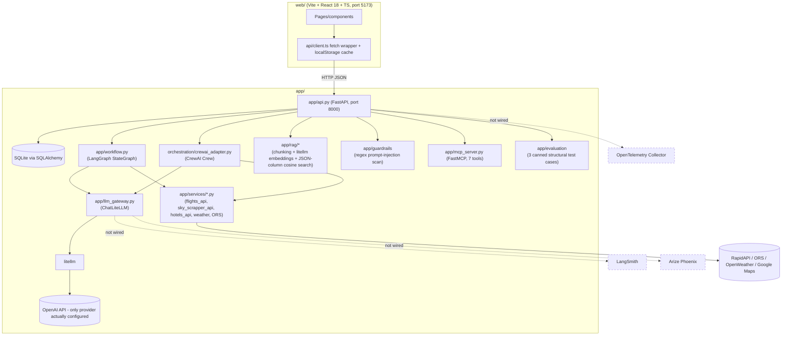

# Voyager AI — Technology Stack Inventory

**Phase 0 audit**, produced in response to a request to build full AI
observability (OpenTelemetry + LangSmith + Arize Phoenix) across Voyager AI.
Per that request's own phase-gating rules ("do not implement everything in
an uncontrolled manner", "do not mark an integration complete until a real
trace has been verified"), this document covers **only the audit** — what is
actually installed, configured, and wired into working code today. Nothing
here was added as part of implementing observability; no new dependency was
installed to produce it. See the end of this document for what Phases 1-7
of that request would actually require before starting them.

Every version below is the version **actually resolved in this checkout's
`.venv_run`/`web/node_modules`** (via `pip freeze` / reading
`node_modules/*/package.json`), not the unpinned range in `requirements.txt`
or the caret range in `package.json` — those two files pin nothing, so the
declared version and the runtime version are not the same question for this
project.

Status labels used throughout: **Active** (real, working code path, exercised
by tests or live-verified in this session) · **Configured** (code reads an
env var for it, but no credential is currently set) · **Optional** (the
feature degrades gracefully without it, by design) · **Partially
Integrated** · **Not Integrated** (installed only as a transitive dependency
of something else, or not installed at all) · **Deprecated**.

---

## 1. Frontend

| Technology | Version (installed) | Purpose | Status | Used in |
|---|---|---|---|---|
| React | 18.3.1 | UI framework | Active | `web/src/**` (all pages/components) |
| TypeScript | 5.9.3 | Language | Active | entire `web/src` tree |
| Vite | 5.4.21 | Build tool / dev server | Active | `web/vite.config.ts` |
| React Router | 6.30.6 | Client-side routing | Active | `web/src/App.tsx` |
| Tailwind CSS | 3.4.19 | Styling | Active | `web/tailwind.config.js`, every component's `className` |
| Leaflet | 1.9.4 | Map rendering | Active | wherever a trip's route/map is shown |
| State management | — | n/a | Not Integrated | No Redux/Zustand/Jotai — plain `useState`/`useEffect` + a hand-written `web/src/api/client.ts` fetch wrapper is the entire data layer |
| Charts/visualization | — | n/a | Not Integrated | No chart library (Chart.js/Recharts/visx) — the Observability/Budget pages render hand-built `<StatTile>`/progress-bar components, not charts |
| UI component library | — | n/a | Not Integrated | No MUI/Radix/shadcn — all components are hand-written in `web/src/components` |
| Icons/SVG | — | static files | Active | `web/public/icons/**` (flat SVG files referenced by path, no icon-font or sprite system) |
| Testing framework | — | n/a | Not Integrated | No Vitest/Jest/Playwright configured for the frontend — `npm run build`'s `tsc -b` type-check is the only frontend CI gate (see `.github/workflows/ci.yml`) |

## 2. Backend

| Technology | Version (installed) | Purpose | Status | Used in |
|---|---|---|---|---|
| Python | 3.13.5 (runtime) / 3.11 (CI, Dockerfile) | Language | Active | all of `app/` |
| FastAPI | 0.162.5 | Web framework / API | Active | `app/api.py` (every `@app.get/post/patch/delete`) |
| Uvicorn | 0.54.0 | ASGI server | Active | run via `uvicorn app.api:app` |
| Pydantic | 2.12.5 | Request/response validation | Active | `app/schemas.py` |
| pydantic-settings | 2.16.2 | — | Not Integrated | installed, but `app/config.py`'s `Config` class reads `os.getenv` directly, not a `BaseSettings` subclass |
| SQLAlchemy | 2.1.8 (declared "SQLAlchemy" in `pip freeze`) | ORM | Active | `app/models_db.py`, `app/db.py` |
| Database migrations | — | n/a | Not Integrated | No Alembic — `app/db.py` creates tables with `Base.metadata.create_all`; schema changes are additive/manual |
| httpx | 0.28.1 | async HTTP client | Partially Integrated | pulled in by FastAPI's `TestClient`/`openai`/`mcp`; app's own provider calls (`app/services/*.py`) use `requests`, not `httpx`, directly |
| requests | 2.34.2 | sync HTTP client | Active | `app/services/flights_api.py`, `sky_scrapper_api.py`, `hotels_api.py`, `amadeus_api.py` (removed), weather/geocoding calls |
| googlemaps | 4.10.0 | Google Maps client | Configured | present as a dependency; only used where `GOOGLE_MAPS_API_KEY`-gated code calls it |
| python-dotenv | — (present) | loads `.env` | Active | `app/config.py` |
| tenacity | 9.2.1 | retry decorators | Configured | installed; not confirmed wired into every provider call — some services roll their own try/except instead |
| Background task execution | — | n/a | Not Integrated | No Celery/RQ/arq — trip generation runs synchronously in the request (or via FastAPI's own background mechanisms where used); "background workers" from the observability request's Part 3.1 do not exist as a separate concept here |
| Authentication | — | n/a | Not Integrated | No user accounts/auth exist anywhere in this app (confirmed in multiple earlier phases of this project) — the only access-control primitive is the trip-sharing `share_token` (Phase 4) |

## 3. Database and persistence

| Technology | Version | Purpose | Status | Used in |
|---|---|---|---|---|
| SQLite | (stdlib, via SQLAlchemy) | Primary datastore | Active | `app/db.py` — a single local `.db` file, no separate DB server |
| Caching | — | n/a | Not Integrated | No Redis/Memcached. The *frontend* has its own `localStorage`-based "offline cache" (`web/src/api/client.ts`, versioned via `CACHE_VERSION`) — not a backend cache |

## 4. AI and LLM frameworks

| Technology | Version | Purpose | Status | Used in |
|---|---|---|---|---|
| LangChain | 1.5.0 | Agent/LCEL chain primitives | Active | `app/agents/*.py`'s `prompt \| self.llm` chains |
| langchain-core | 1.8.0 | — | Active | transitive, used by the above |
| langchain-community | 0.4.2 | — | Partially Integrated | pulled in for specific community integrations (e.g. the `AmadeusToolkit` langchain ships, which this app does **not** use — it calls Amadeus/Sky Scrapper directly via `requests` in `app/services/`) |
| langchain-classic | 1.0.8 | — | Not Integrated | transitive dependency of `langchain`/`langchain-community`, not imported directly by app code |
| langchain-openai | 1.7.4 | OpenAI chat model wrapper | Partially Integrated | present, but the primary chat-model construction path is `langchain-litellm`'s `ChatLiteLLM` (see below), not `ChatOpenAI` directly |
| langchain-litellm | 0.11.1 | LiteLLM↔LangChain bridge | Active | `app/llm_gateway.py` — every agent's LLM call goes through `ChatLiteLLM` |
| LiteLLM | 1.109.1 | Provider-agnostic model routing | Active | `app/llm_gateway.py` (chat), `app/rag/embeddings.py` (embeddings via `litellm.embedding`) |
| LangGraph | 1.2.20 | Stateful agent graph orchestration | Active | `app/workflow.py` — the primary orchestrator (`StateGraph`, 6 nodes, see Part 4) |
| CrewAI | 1.15.40 | Alternative agent orchestration | Active | `app/orchestration/crewai_adapter.py` — same 4-6 steps as LangGraph, via `Agent`/`Task`/`Crew` |
| OpenAI SDK | 2.54.0 | direct client used by LiteLLM under the hood | Active | transitive, not called directly by app code |

## 5. Agent orchestration

| Technology | Version | Purpose | Status | Used in |
|---|---|---|---|---|
| LangGraph StateGraph | 1.2.20 | primary orchestrator | Active | `app/workflow.py` — research → flights → accommodation → transportation → dining → itinerary |
| CrewAI Crew | 1.15.40 | secondary/comparison orchestrator | Active | `orchestration/crewai_adapter.py` — same 6-step sequence, selectable per-trip via `framework` field |
| Trace/observability field on `Trip` | n/a (custom, ~15 lines) | per-step `{step, duration_ms, status, error}` list | Active, but shallow | `app/workflow.py`'s `_trace_entry()`, `Trip.trace` (JSON column). **This is the entirety of "observability" in the app today** — a flat list, no trace/span IDs, no parent-child hierarchy, no token/cost capture, not exported anywhere. `status: "success"` only means "the step didn't raise" — it does not mean real data was found (documented and partially worked around in the Workflows UI's `foundRealFor()`, see `docs/VOYAGER_IMPLEMENTATION_AUDIT.md` Phase 11k) |
| Agent Studio / "AGENT_CATALOG" | n/a | descriptive-only registry for the AI Engineering Workspace UI | Active (UI-only) | predates the flights/transportation steps; a separate, hand-maintained list from `PIPELINE_STEPS`, not derived from it |

## 6. Model providers

| Provider | Registered in `MODEL_REGISTRY` | Credential present in `.env` | Status |
|---|---|---|---|
| OpenAI (`gpt-4o-mini`, `gpt-4o`) | Yes | `OPENAI_API_KEY` ✅ | **Active** — this is the only provider any real trip in this checkout has actually been planned with |
| Anthropic (`claude-3-5-sonnet-20241022`) | Yes | `ANTHROPIC_API_KEY` ❌ not set | Configured, not active |
| Google Gemini (`gemini-1.5-flash`) | Yes | `GOOGLE_API_KEY` ❌ not set | Configured, not active |
| Ollama (`llama3`, local) | Yes | n/a (local server) | Configured, not active — `is_configured()` reports `True` for local models without checking the Ollama server is actually reachable |

Any future observability "model performance comparison" view must **not**
show Anthropic/Gemini/Ollama rows with data — there is none, by the above.

## 7. Embeddings and vector databases

| Technology | Version | Purpose | Status | Used in |
|---|---|---|---|---|
| OpenAI embeddings (via LiteLLM) | n/a | text embedding for RAG | Active (requires `OPENAI_API_KEY`, which is set) | `app/rag/embeddings.py` |
| Vector database | — | n/a | **Not Integrated** | `chromadb` 1.5.9 is present in `pip freeze` but is a **transitive** dependency (pulled in by crewai/mcp tooling) — grep across `app/` finds zero imports of `chromadb`. Embeddings are stored as a plain JSON column (`KnowledgeChunk.embedding`) and similarity search is brute-force cosine similarity in Python, not a vector index |

## 8. RAG

| Component | Status | Used in |
|---|---|---|
| Chunking | Active | `app/rag/chunking.py` |
| Embedding generation | Active | `app/rag/embeddings.py` |
| Retrieval | Active (linear scan, no ANN index) | `search_knowledge` in `app/api.py` / `app/mcp_server.py` |
| Reranking | Not Integrated | none |
| Citation handling | Not Integrated | retrieved chunks are concatenated into the research agent's prompt; no inline citation markers are produced |

## 9. MCP

| Component | Version | Status | Used in |
|---|---|---|---|
| `mcp` SDK | 1.30.0 (pinned `<2` in `requirements.txt` — `mcp` 2.x renamed `mcp.server.fastmcp.FastMCP`, which would break the import below) | Active | `app/mcp_server.py` |
| Server architecture | `FastMCP` | Active | one process, `app/mcp_server.py` |
| Tools exposed | 7: `list_models`, `list_frameworks`, `list_agents`, `plan_trip`, `get_trip`, `list_trips`, `search_knowledge` | Active | same file |
| Client integration | Not Integrated | nothing in this repo acts as an MCP *client* — Voyager is MCP-server-only |

## 10. Observability and monitoring

**Updated after Phase 12** (see `docs/VOYAGER_IMPLEMENTATION_AUDIT.md`'s Phase
12 entry for the full build log). The table below reflects the state after
that phase, not the pre-Phase-12 state this audit originally documented.

| Technology | Version (if present) | Status |
|---|---|---|
| OpenTelemetry SDK/API | `opentelemetry-api`/`-sdk` 1.45.2, OTLP exporters 1.45.2/0.66b2 | **Active**, gated behind `OTEL_ENABLED` (default `false`). `app/observability/` builds a `TracerProvider` with a custom `DBSpanExporter` persisting every span to a new `Span` table, plus FastAPI and `requests` auto-instrumentation (`opentelemetry-instrumentation-sqlalchemy` is installed but confirmed **inert** — its own version guard refuses SQLAlchemy 2.1.8). Custom spans cover trip generation, every LangGraph node and CrewAI tool closure, and every LLM call, with secret/PII redaction applied before persistence. Live-verified: a real trip produced a correctly-nested 27-span trace. |
| LangSmith | `langsmith` 0.14.17 | **Active**, gated behind `LANGSMITH_TRACING` (default `false`). No application code — LangChain's own SDK reads `LANGSMITH_TRACING`/`LANGSMITH_API_KEY`/`LANGSMITH_PROJECT` from the environment and traces every `ChatLiteLLM.invoke()` call automatically. Known limitation: does not cover CrewAI's own `crewai.LLM`-based tool-selection reasoning, only the shared underlying agent model calls. Live-verified against a real tracing-scoped API key with a real trip generation (no send-failure logged); user to confirm the trace is visible in the LangSmith UI. |
| Arize Phoenix | `arizephoenix/phoenix:latest` (21.0.0) | **Active**, live-verified — runs as its own Docker service (`docker-compose.yml`'s `phoenix` service, official image) talking to Voyager purely over OTLP/HTTP (`PHOENIX_COLLECTOR_ENDPOINT` + `PHOENIX_API_KEY`, gated behind `PHOENIX_ENABLED`), deliberately never pip-installed into this app's venv (confirmed live: its `fastmcp`/`pydantic-ai` dependency chain breaks `app/mcp_server.py`'s `mcp<2` pin and crewai's `openai<3` pin, down to breaking `pytest` collection itself). Phoenix 21.x enables login/auth by default, which also protects its OTLP collector — requires an API key from its own UI, passed as an `Authorization: Bearer` header. A real trip produced 9 spans visible in Phoenix's Tracing view. **Known gap**: Phoenix's SQLite DB lives at `/root/.phoenix/phoenix.db` inside the container, not under the `phoenix-data` volume mount — traces don't currently survive container recreation. |
| Prometheus | — | **Not Integrated** — not installed, no `/metrics` endpoint exists. |
| Grafana | — | **Not Integrated** — no dashboard config of any kind exists in the repo. |
| Voyager's own `Trip.trace` field | custom | **Active**, unchanged by Phase 12 — still a flat per-trip list of step timings, rendered by `web/src/pages/Observability.tsx`/`Workflows.tsx`. The new `Span` table is a separate, richer store; the Observability UI has not yet been rebuilt to read from it (Phase 4, not started). |
| Logging | stdlib `logging` | Active | `app/utils/logger.py` — a single `StreamHandler` to stdout, plain text formatter, no structured/JSON logging, no correlation IDs, no shipping to any log backend. |

## 11. Evaluation and testing

| Technology | Status | Used in |
|---|---|---|
| pytest / pytest-asyncio | Active (336 tests passing as of this session) | `tests/` |
| Custom structural evaluator (Phase 8) | Active | `app/evaluation/__init__.py` — 3 canned cases, graded by hand-written assertions ("did attractions/itinerary come back non-empty and not an error placeholder") |
| LLM-as-judge | Not Integrated | no second model call is used to grade anything |
| Ragas | Not Integrated | not installed |
| DeepEval | Not Integrated | not installed |
| Phoenix Evaluations | Not Integrated | Phoenix itself isn't installed |
| Frontend tests | Not Integrated | see Part 1 |

## 12. Security and guardrails

| Technology | Status | Used in |
|---|---|---|
| Prompt-injection scanner | Active | `app/guardrails/__init__.py` — regex/keyword heuristics (not an ML classifier, not an LLM judge, documented as such in the module's own docstring), scanning RAG knowledge content and a trip's `destination` field before it reaches a prompt |
| Secret management | `.env` + `python-dotenv`, read via `os.getenv` in `app/config.py` | Active — no secrets manager/vault; this is appropriate for the project's single-developer/local-first scope |
| Dependency scanning | Not Integrated | no Dependabot/Snyk/pip-audit config found |
| Output/PII redaction in logs | Not Integrated | `app/utils/logger.py` has no redaction logic — anything passed to `logger.warning(...)` goes to stdout as-is. Relevant for any future tracing work: none of today's log calls include raw API keys (checked), but there is no systematic guard against it either |

## 13. External travel APIs

| Provider | Purpose | Status |
|---|---|---|
| RapidAPI "flights-sky" (`flights_api.py`) | primary real flight search | Active (RAPIDAPI_KEY set), but its own quota is currently exhausted in practice |
| RapidAPI "Sky Scrapper" (`sky_scrapper_api.py`) | fallback real flight search | Active — same RAPIDAPI_KEY, separate quota, live-verified this session |
| RapidAPI "booking-com15" (`hotels_api.py`) | real accommodation search | Active when quota allows; currently quota-exhausted per earlier investigation in this project |
| OpenRouteService (`ORS_API_KEY`) | geocoding / routing | Configured; quota-exhausted per earlier investigation |
| OpenWeather (`OPENWEATHER_API_KEY`) | weather | Configured |
| Google Maps (`googlemaps` package) | maps/places | Configured, gated by its own key |
| Amadeus Self-Service Flight Offers | — | **Removed this session** — Amadeus decommissioned its self-service developer portal; code was deleted rather than left dormant with no viable credential path |
| Kiwi.com Tequila | — | **Never integrated** — investigated and ruled out this session (closed to public self-service since 2024) |

## 14. Infrastructure and deployment

| Technology | Status | Notes |
|---|---|---|
| Dockerfile | **Stale** | Builds and runs `streamlit run streamlit_app.py` on port 8501 — this predates the FastAPI+React rewrite documented throughout `docs/VOYAGER_IMPLEMENTATION_AUDIT.md`'s later phases. It does not build or serve `app/api.py` or `web/` at all. |
| docker-compose.yml | **Stale**, same reason | Only defines the one Streamlit service; no Postgres/Redis/OTel-collector/Phoenix service exists. |
| Reverse proxy | Not Integrated | none |
| CI/CD | Active | `.github/workflows/ci.yml` — two jobs: backend (`pip install` + `pytest` + non-blocking `flake8`), frontend (`npm ci` + `tsc -b` + `vite build`). No deployment step. |
| Local dev | Active | backend via `uvicorn app.api:app` (no `--reload` in this session's usage), frontend via `vite` dev server on port 5173 |

## 15. Development and CI/CD tools

| Technology | Version | Status |
|---|---|---|
| black | 26.10.1 | Configured (not enforced in CI — no `black --check` step) |
| flake8 | 7.5.0 | Active, but **informational only** — CI runs it with `\|\| true`, so lint failures never fail the build (documented in the workflow's own step name) |
| pytest | 9.2.0 | Active |
| ESLint (`web/.eslintrc`/flat config) | present per `package.json`'s `lint` script | Configured; not run in CI (`ci.yml`'s frontend job runs `build`, not `lint`) |

---

## Architecture diagram (as built, not as targeted)

The dashed boxes are the Part 2 target architecture from the observability
request — none of the three exist in this codebase today, including as
disabled/stubbed code paths.

---

## What this means for the observability request's Phases 1-7

Per that request's own Part 15 exit criteria and Part 11/12 rules, before any
of Phases 1-7 can start, the following **decisions need the user's input**
(not something to silently choose and install):

1. **LangSmith** needs a `LANGSMITH_API_KEY` and a project — this is a
   hosted SaaS product (LangChain's own), not something that runs locally.
   Someone needs to create an account and provide a key.
2. **Arize Phoenix** can run fully locally (its own Part 5.2 says so) via
   `pip install arize-phoenix` + a local launch call — no account needed,
   but it is a new, fairly heavy dependency (brings its own OTel exporters,
   a local web UI, optional DB). Worth confirming before installing.
3. **OpenTelemetry** itself (SDK + FastAPI/SQLAlchemy/requests
   auto-instrumentation packages) is the one piece that can be added with
   zero external accounts — it would need `opentelemetry-instrumentation-
   fastapi`, `-sqlalchemy`, `-requests` (none currently installed; only the
   bare SDK/exporter packages are present transitively).
4. **Dockerfile/docker-compose.yml are stale** (Part 14) — if any Phase 1-7
   deliverable includes a Collector or Phoenix container, this is the point
   to also fix compose to actually run the real app (FastAPI + Vite) instead
   of the long-superseded Streamlit entrypoint, rather than bolting new
   services onto infrastructure nothing uses.
5. Given `Trip.trace` is a flat per-step list (Part 5), true parent/child
   span hierarchy (per the request's Part 3.1 example tree) is new
   instrumentation work inside `app/workflow.py`/`crewai_adapter.py`/
   `app/llm_gateway.py` — not a config change, and not something any of the
   three target backends provide for free without that code emitting real
   spans.

Recommended next step: confirm which of LangSmith/Phoenix/OTel the user
wants to actually commit to (accounts, new dependencies, Docker changes)
before Phase 1 code is written, per this document's own Part 15 gating.
